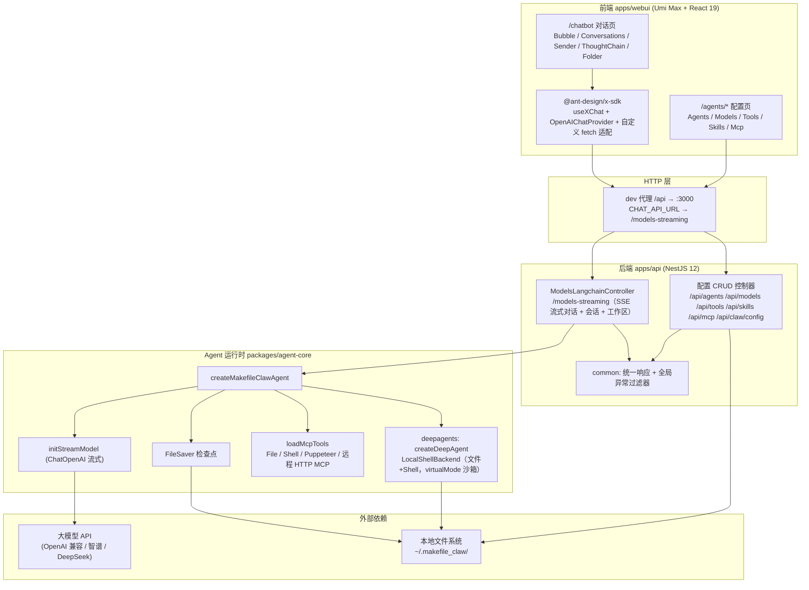
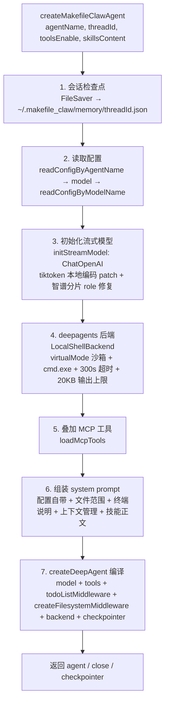
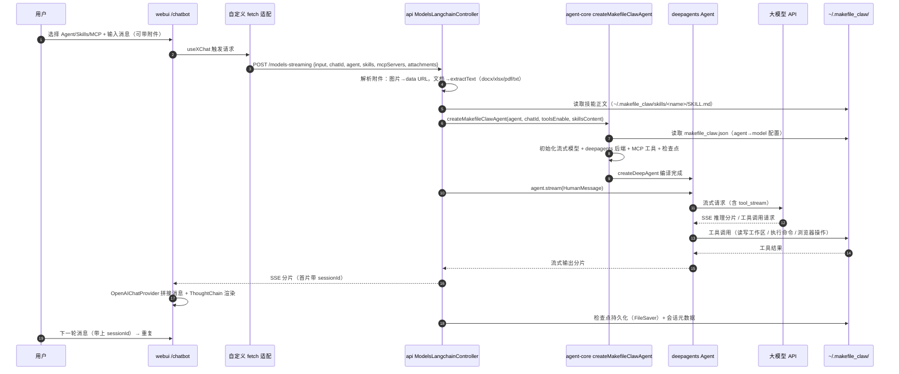

# makefile_claw 项目整体架构

> 一个本地运行的 **AI Agent 智能体工作台**：对话式 Agent 支持文件 / Shell / 浏览器操作，可扩展 MCP 工具、注入 Skills、切换多模型，全部配置与会话状态持久化在本地文件系统，无需数据库。

---

## 1. 技术栈一览

| 层 | 技术选型 |
| --- | --- |
| Monorepo 管理 | pnpm workspaces（根 `package.json` 同时声明 npm workspaces：`packages/*`、`apps/*`） |
| 后端 | NestJS 12 + Express、TypeScript 6（ESM）、Vitest、oxlint、`@nestjs/observe`（可观测性） |
| 前端 | Umi Max 4 + React 19 + Ant Design 6、`@ant-design/x`（AI 聊天 UI）、`@ant-design/x-sdk`、React Query、Biome、Husky、Vitest |
| Agent 运行时 | LangChain 1 + LangGraph + **deepagents** + `@modelcontextprotocol/sdk` |
| 文档解析 | `mammoth`（docx）、`xlsx`、`pdf-parse`、`js-yaml` |
| 部署形态 | 本地服务（api :3000 + webui :8000），前端开发代理 `/api` → 后端 |

---

## 2. 仓库结构

```
makefile_claw/
├── package.json              # 根：workspaces = packages/*, apps/*；统一 build/test/lint/clean
├── pnpm-workspace.yaml
├── agent/skills/             # 内置技能文档（Vercel/React 最佳实践），可拷贝到 ~/.makefile_claw/skills 供 Agent 注入
├── .postman/resources.yaml   # 后端 API 接口集合
│
├── apps/
│   ├── api/                  # NestJS 后端服务（端口 3000）
│   │   └── src/
│   │       ├── main.ts                 # 启动入口：CORS、50mb body、全局异常过滤器
│   │       ├── app.module.ts           # 根模块：装配 ObserveModule + 各业务模块
│   │       ├── common/                 # 统一响应封装 + 全局异常过滤器
│   │       ├── claw-config/            # 全局配置读写（~/.makefile_claw/makefile_claw.json）
│   │       ├── agents/                 # Agent 配置 CRUD
│   │       ├── models/                 # Model 配置 CRUD + 流式对话控制器（核心）
│   │       ├── tools/                  # Tool 配置 CRUD
│   │       ├── skills/                 # 技能安装/启停/删除
│   │       └── mcp/                    # MCP 服务器配置 CRUD
│   │
│   └── webui/                # Ant Design Pro 前端（端口 8000）
│       ├── config/
│       │   ├── routes.ts               # 路由表（/chatbot 为核心，/agents/* 为配置页）
│       │   └── proxy.ts                # 开发代理：/api → http://localhost:3000
│       ├── cloudflare-worker/          # 模板自带的 demo mock 服务（与核心无关，可忽略）
│       └── src/
│           ├── pages/chatbot/          # ★ AI 对话主界面（核心业务）
│           ├── pages/agents/           # Agents / Models / Tools / Skills / Mcp 配置页
│           └── ...                     # 其余为 Ant Design Pro 模板示例页（默认 hideInMenu）
│
└── packages/
    └── agent-core/           # ★ Agent 核心运行时（被 apps/api 依赖）
        └── src/
            ├── index.ts                  # createMakefileClawAgent — 组装并编译 Agent
            ├── agents.ts                 # initStreamModel — 初始化流式 ChatOpenAI（含兼容补丁）
            ├── readConfig.ts             # 每次从磁盘读取 agent/model 配置
            ├── FileSaver.js              # LangGraph 检查点持久化（一会话一文件）
            └── mcp/
                ├── index.ts              # loadMcpTools — 文件/Shell/Puppeteer/远程 MCP 工具加载
                └── terminal-registry.ts  # 终端会话注册表（托管 MCP terminal_* 生命周期）
```

---

## 3. 分层架构



---

## 4. 后端模块与 API 清单

### 4.1 模块装配（[app.module.ts](file:///d:/AI项目二/makefile_claw/apps/api/src/app.module.ts)）

`AppModule` 依次导入：
- `ObserveModule` — NestJS Observe 可观测性（分布式追踪 / 指标 / 错误遥测，密钥来自环境变量）
- `ClawConfigModule` → `AgentsModule` → `ModelsModule` → `ToolsModule` → `SkillsModule` → `McpModule`

### 4.2 配置 CRUD 接口（统一前缀 `/api`，统一响应封装 `{ success, data, message }`）

| 方法 | 路径 | 说明 | 数据来源 |
| --- | --- | --- | --- |
| GET / PUT | `/api/claw/config` | 整体配置读写（models/tools/mcpServers 受保护，不允许整体覆盖） | `makefile_claw.json` |
| GET / POST / PUT / DELETE | `/api/agents`、`/api/agents/:name` | Agent 配置增删改查 | `makefile_claw.json` |
| GET / POST / PUT / DELETE | `/api/models`、`/api/models/:name` | 模型配置增删改查 | `makefile_claw.json` |
| GET / POST / PUT / DELETE | `/api/tools`、`/api/tools/:name` | 工具配置增删改查 | `makefile_claw.json` |
| GET / DELETE | `/api/skills`、`/api/skills/:name` | 技能列表 / 删除 | `~/.makefile_claw/skills/` |
| GET | `/api/skills/:name` | 技能详情（含正文内容） | `SKILL.md` |
| POST | `/api/skills/install` | 安装技能（`skills.sh` 命令 → `pnpm dlx`，失败回退 git clone 镜像） | `~/.makefile_claw/skills/` |
| PATCH | `/api/skills/:name/active` | 启停技能 | `skill.meta.json` |
| GET / POST / PUT / DELETE | `/api/mcp`、`/api/mcp/:name` | 远程 MCP 服务器配置增删改查 | `makefile_claw.json` |

### 4.3 流式对话核心接口（前缀 `/models-streaming`，**无 `/api`**，SSE 兼容 OpenAI 格式）

由 [models.langchain.controller.ts](file:///d:/AI项目二/makefile_claw/apps/api/src/models/models.langchain.controller.ts) 提供：

| 方法 | 路径 | 说明 |
| --- | --- | --- |
| POST | `/models-streaming` | ★ 流式对话。Body：`{ input, chatId, agent, skills, mcpServers, attachments }`，返回 SSE 分片（首片带 `sessionId`） |
| GET | `/models-streaming/sessions` | 历史会话列表 |
| GET | `/models-streaming/sessions/:threadId/messages` | 指定会话的历史消息 |
| POST | `/models-streaming/sessions/:threadId/title` | 自动生成会话标题（已手动改名则不覆盖） |
| PUT | `/models-streaming/sessions/:threadId/title` | 手动重命名标题 |
| DELETE | `/models-streaming/sessions/:threadId` | 删除会话（检查点 + 元数据文件） |
| GET | `/models-streaming/workspace/tree` | 工作区文件树（供前端 Folder 组件渲染） |
| GET | `/models-streaming/workspace/file?path=...` | 读取工作区内指定文件内容 |

---

## 5. Agent 核心运行时（packages/agent-core）

入口函数 [createMakefileClawAgent](file:///d:/AI项目二/makefile_claw/packages/agent-core/src/index.ts#L35)：



### 5.1 工具分层

Agent 可用工具来自两层叠加：

1. **deepagents 内置（基础工具集，始终可用）**
   - `createFilesystemMiddleware`：`read_file / write_file / edit_file / ls / glob / grep / delete`，通过 `virtualMode: true` 严格限制在工作区目录内，拒绝绝对路径穿透与 `..` 越界。
   - `LocalShellBackend.execute`：命令执行（Windows 下走 `cmd.exe`）。
   - `todoListMiddleware`：`write_todos` 任务清单。

2. **MCP 工具（按开关叠加，见 [mcp/index.ts](file:///d:/AI项目二/makefile_claw/packages/agent-core/src/mcp/index.ts)）**
   - `fileTools`：`@modelcontextprotocol/server-filesystem`（Stdio 子进程）—— 与内置文件工具重名的会被排除，避免冲突。
   - `shellTools`：`@mako10k/mcp-shell-server`（Stdio）—— 提供 `terminal_create / terminal_operate / terminal_close` 持久终端，由 `terminal-registry` 代码层托管生命周期，close 时逐个清理。
   - `puppeteerTools`：`@modelcontextprotocol/server-puppeteer`（Stdio）—— 浏览器自动化，优先使用系统已装 Chrome（探测 `PUPPETEER_EXECUTABLE_PATH` 等）。
   - 远程 MCP：`StreamableHTTPClientTransport` 连接公网 MCP（如 GitHub MCP，由 `GITHUB_TOKEN` / `MCP_REMOTE_SERVERS` 环境变量自动注入）。

> **资源回收**：`close()` 先优雅关闭 MCP 终端，再 `taskkill /T /F` 强杀本地 MCP 子进程树（Windows），最后关闭所有 MCP 客户端连接，防止僵尸进程。

### 5.2 模型初始化兼容补丁（[agents.ts](file:///d:/AI项目二/makefile_claw/packages/agent-core/src/agents.ts)）

- **tiktoken 本地化**：拦截 `https://tiktoken.pages.dev/js/` 请求，改用 `js-tiktoken` 内置的本地 `cl100k_base` 编码数据，解决网络不通导致 token 计数超时卡顿。
- **智谱流式分片修复**：智谱 `reasoning_content` 分片缺少 `role`，LangChain 转换后生成 `role` 为 `undefined` 的消息，持久化后上报触发 400；重写 `_convertCompletionsDeltaToBaseMessageChunk` 与 `withConfig` 保证新实例同样生效。
- 模型 API 超时 120s、禁用自动重试，避免超时后重试进一步拉长等待。

---

## 6. 前端架构（apps/webui）

### 6.1 路由（[config/routes.ts](file:///d:/AI项目二/makefile_claw/apps/webui/config/routes.ts)）

核心业务路由：

| 路由 | 页面 | 说明 |
| --- | --- | --- |
| `/chatbot` | [chatbot/index.tsx](file:///d:/AI项目二/makefile_claw/apps/webui/src/pages/chatbot/index.tsx) | ★ AI 对话主界面 |
| `/agents/agents` | agents/Agents.tsx | Agent 配置管理 |
| `/agents/models` | agents/Models.tsx | 模型配置管理 |
| `/agents/tools` | agents/Tools.tsx | 工具配置管理 |
| `/agents/skills` | agents/Skills.tsx | 技能安装与启停 |
| `/agents/mcp` | agents/Mcp.tsx | 远程 MCP 服务器配置 |

其余 `/welcome`、`/dashboard/*`、`/form/*`、`/list/*`、`/profile/*`、`/result/*`、`/exception/*`、`/account/*` 均为 Ant Design Pro 模板自带示例页（默认 `hideInMenu: true`）。

### 6.2 Chatbot 页面交互模型

前端基于 `@ant-design/x` 的 `useXChat` + `OpenAIChatProvider`，通过 [自定义 fetch 适配器](file:///d:/AI项目二/makefile_claw/apps/webui/src/pages/chatbot/service.ts#L160) 把 Ant Design X 默认的「POST messages 数组」改写成后端约定的请求体：

```
POST /models-streaming
{
  input,        // 最后一条用户消息
  chatId,       // 会话 ID（上一轮返回的 sessionId），空则新建
  agent,        // 选中的 Agent 名称
  skills,       // 逗号分隔的技能名
  mcpServers,   // 选中的远程 MCP 服务器名数组
  attachments   // 附件：图片 base64（多模态）/ 文档 base64（后端提取文本）
}
```

- **SSE 接收**：`OpenAIChatProvider` 自动解析分片拼接消息；`onUpdate` 回调从首片提取 `sessionId` 回传，实现多轮记忆。
- **思考链展示**：`ThoughtChain` 组件渲染模型推理 / 工具调用过程。
- **工作区浏览**：右侧 `Folder` 组件通过 `/workspace/tree` 与 `/workspace/file` 展示并读取 Agent 生成的文件。
- **选择持久化**：每个会话的 agent / skills / mcpServers 选择保存在 `localStorage`，刷新不丢失。

### 6.3 开发代理（[config/proxy.ts](file:///d:/AI项目二/makefile_claw/apps/webui/config/proxy.ts)）

```
dev:  /api/  →  http://localhost:3000
```

> 注意：流式对话地址 `/models-streaming` **不经过** `/api` 代理，而是由 `CHAT_API_URL` 环境变量直接指定（默认 `http://localhost:3000/models-streaming`），因此后端 `main.ts` 启用了 `enableCors()`。

---

## 7. 配置与持久化（无数据库，全本地文件）

所有状态持久化在用户主目录 `~/.makefile_claw/` 下：

```
~/.makefile_claw/
├── makefile_claw.json      # 全局配置：agents / models / tools / mcpServers（每次磁盘读取，支持热修改）
├── memory/
│   └── <threadId>.json     # LangGraph 会话检查点（一会话一文件，FileSaver 持久化）
├── skills/
│   └── <name>/
│       ├── SKILL.md         # 技能正文（YAML frontmatter + markdown，注入到 system prompt）
│       └── skill.meta.json  # 安装元数据（来源 / 时间 / 启用状态）
└── workspaces/              # Agent 工作区（文件操作沙箱根，MAKEFILE_CLAW_WORKSPACE 可覆盖）
```

关键点：
- 配置**不做模块级缓存**，每次读取都从磁盘加载，保证 Web UI 修改配置后无需重启后端即刻生效（见 [readConfig.ts](file:///d:/AI项目二/makefile_claw/packages/agent-core/src/readConfig.ts) 注释）。
- Agent 的文件操作被 `virtualMode` 限制在 `workspaces/` 内；若技能文档引用工作区外文件，需通过 `execute` shell 命令读取。
- 单会话一个检查点文件，隔离性好但会话多时会产生大量小文件。

---

## 8. 核心数据流：一次对话的完整链路



---

## 9. 本地开发启动

```bash
# 1. 安装依赖（根目录，pnpm 会处理 workspace）
pnpm install

# 2. 启动后端（端口 3000）
cd apps/api && pnpm run start:dev

# 3. 启动前端（端口 8000，自动代理 /api → :3000）
cd apps/webui && pnpm run dev
```

首次运行前需在 `~/.makefile_claw/makefile_claw.json` 配置至少一个可用模型（`base_url` / `api_key`）和一个 Agent，或通过前端 `/agents/models` 页面添加。

---

## 10. 设计要点与约束

1. **无状态后端 + 本地文件持久化**：后端不维护会话内存状态，全部靠 LangGraph checkpointer + 文件系统，天然支持重启续聊。
2. **沙箱安全**：文件工具通过 `virtualMode` 限制在工作区；`execute` 输出截断到 20KB 防止上下文爆炸；命令超时 300s。
3. **上下文管理**：system prompt 明确要求模型每 8–10 次工具调用后向用户汇报，避免长任务因上下文过大中断。
4. **工具降级容错**：任一 MCP 子服务加载失败（文件 / Shell / Puppeteer / 远程）仅记录日志，不阻断 Agent 创建——deepagents 内置工具可兜底。
5. **配置一致性**：`/api/claw/config` 的 PUT 对 `models / tools / mcpServers` 字段做保护（始终以磁盘最新为准），避免与各自独立接口并发覆盖。
6. **进程清理**：MCP 子进程树在会话结束时通过 `taskkill /T /F`（Windows）强杀 + 终端注册表逐个关闭，防止僵尸进程堆积。
