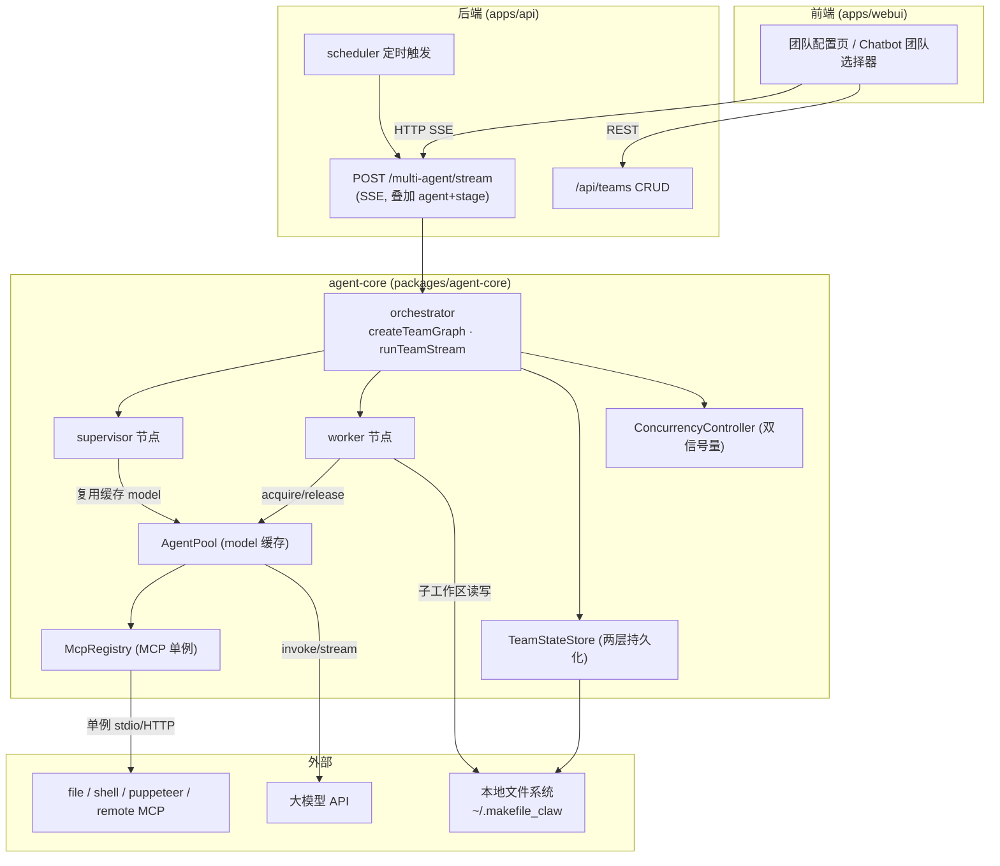
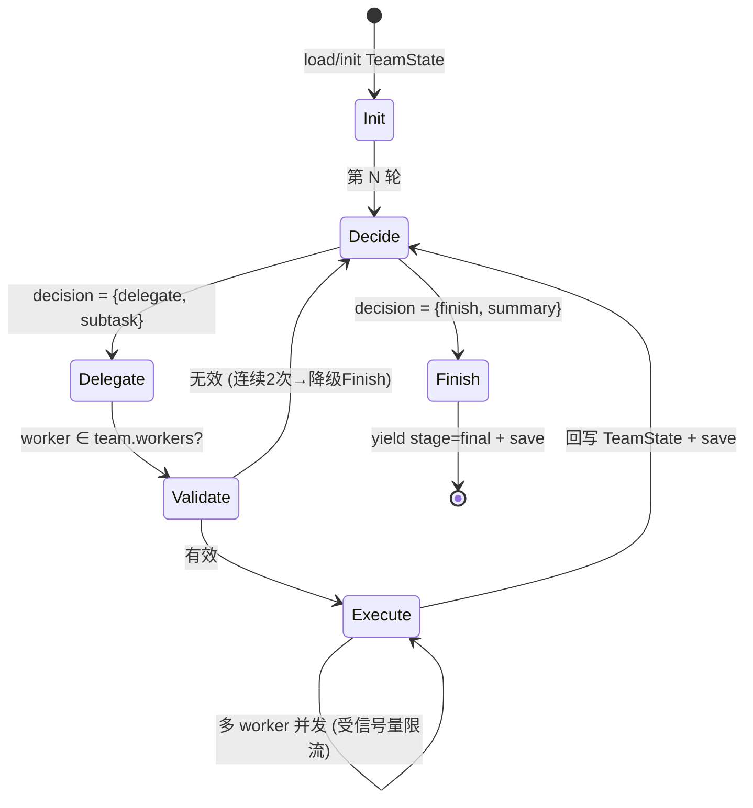
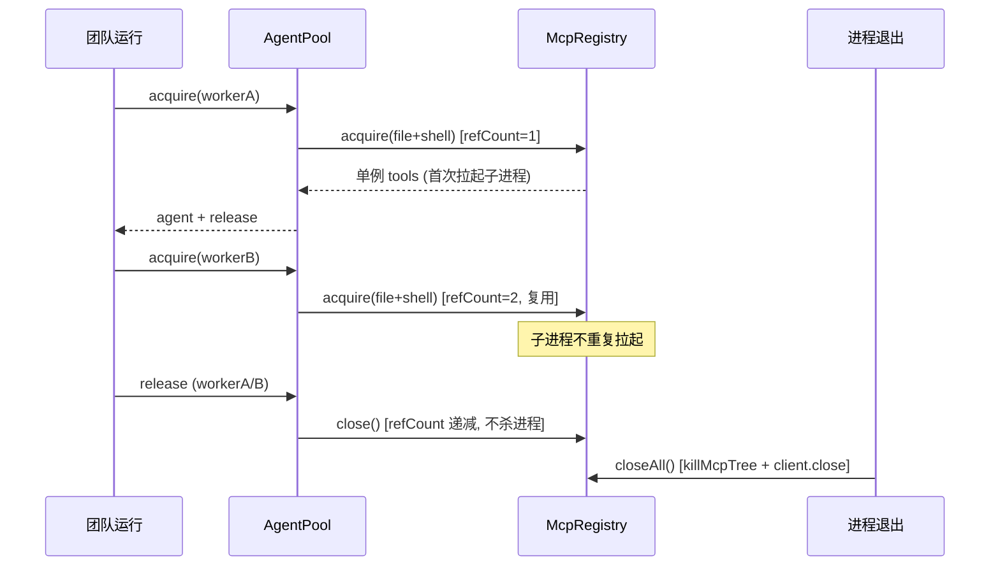

# Makefile Claw 多智能体协作设计文档

> 版本：v1.0 · 对应实现阶段：Spec Mode 实施完成（Task 1–9），前端 / CLI / 调度 / 端到端验证进行中。

## 1. 背景与目标

Makefile Claw 原先是**单智能体**工作台：每次 HTTP 请求 `createMakefileClawAgent` 都会 `new model + new backend + 拉起 MCP stdio 子进程`，检查点按 `threadId` 单文件持久化，所有 Agent 共用一个工作区根目录，前端是单选 Agent UI，SSE 分片不带角色标识，也没有并发控制。

本设计在**不破坏单 Agent 既有流程**的前提下，引入**模式 C：层级编排（主管动态委派）**，让多个 Worker Agent 协同完成复杂任务，并解决以下 6 个约束：

| # | 约束 | 解法 |
|---|------|------|
| 1 | 每次请求重建 Agent（成本 ×N，MCP 子进程重复拉起抢资源） | `AgentPool` 缓存 model；`McpRegistry` 进程级单例复用 file/shell/puppeteer MCP 子进程 |
| 2 | 检查点按 threadId 单文件，无团队/子状态两层 | `TeamStateStore`（团队共享 `memory/team-<id>.json`）+ worker 子检查点 `memory/team-<id>/<worker>.json` |
| 3 | 工作区共享无隔离，并行写冲突 | 每 worker 子工作区 `workspaces/<teamId>/<worker>` + 团队共享目录 `workspaces/<teamId>/shared` |
| 4 | 前端单选 Agent，无团队编排概念 | 新增团队配置页 + chatbot 团队选择器（与单 Agent 互斥） |
| 5 | SSE 无角色标识，多 Agent 输出无法区分 | 团队流分片叠加 `agent` + `stage` 字段；单 Agent 分片格式不变 |
| 6 | 无并发控制，并行打爆模型 API / 进程 | `ConcurrencyController`：全局 `maxParallelWorkers` + 单 Agent `maxConcurrency` 双信号量 |

## 2. 协作模式选型

三种候选模式：

- **A. Pipeline（流水线）**：固定顺序 A→B→C，简单但不灵活。
- **B. Parallel（并行散跑）**：所有 worker 同时跑同一任务的不同切面，需人工定义切分。
- **C. Hierarchy（层级 / 主管动态委派）**：Supervisor 读取进展，动态决定下一个委派给谁、做什么，或结束。最灵活，能处理开放任务。

**选 C**。Supervisor 与 Worker **共享模型 / 工具池**（不各自建连），但**状态与工作区隔离**。Supervisor 不持有工具（只做决策），Worker 持有完整工具链。

## 3. 整体架构



## 4. 编排流程（Supervisor 状态机）



关键规则：

- Supervisor 每轮读 `TeamState`（任务 / 进展消息 / 产物 / 委派历史），组装 prompt，要求模型**只输出 JSON**。
- 解析容错：去 markdown 围栏 → 提取首个 `{...}` → 修复常见语法 → 兼容字段名；失败重试一次，仍失败降级 finish。
- 委派无效目标（不在 `team.workers`）→ 写 system 提示 + error 事件，连续 2 次降级结束，防死循环。
- 单个 Worker 抛错 → 捕获归因写入 `delegationHistory` + error 事件，不中断团队，Supervisor 下轮可见。
- 最大委派轮次 `maxRounds`（默认 8）兜底。

## 5. 数据模型

### 5.1 配置扩展（`~/.makefile_claw/makefile_claw.json`）

`ClawConfig` 新增 `teams: TeamConfig[]`，`AgentConfig` 新增可选字段：

| 字段 | 类型 | 说明 | 默认 |
|------|------|------|------|
| `AgentConfig.role` | `string?` | 角色描述 | — |
| `AgentConfig.capabilities` | `string[]?` | 能力标签（供 Supervisor 选 worker） | — |
| `AgentConfig.workspace` | `string?` | 自定义工作区（单 Agent 用） | — |
| `AgentConfig.maxConcurrency` | `number?` | 该 Agent 最大并发 execute 数 | 2 |
| `TeamConfig.name` | `string` | 团队名（唯一） | — |
| `TeamConfig.supervisor` | `string` | 主管 Agent 名 | — |
| `TeamConfig.workers` | `string[]` | Worker Agent 名列表 | — |
| `TeamConfig.mode` | `'hierarchy'\|'pipeline'\|'parallel'` | 协作模式（首期仅 hierarchy 生效） | `hierarchy` |
| `TeamConfig.maxParallelWorkers` | `number?` | 全局最大并行 Worker 数 | 3 |
| `TeamConfig.edges` | `{from,to}[]?` | 预留（pipeline 模式用） | — |
| `TeamConfig.active` | `boolean?` | 是否启用 | true |

`teams` 字段受 `PUT /api/claw/config` 保护（同 models/tools/mcpServers，只走 `/api/teams` 增删改）。

### 5.2 两层持久化（`~/.makefile_claw`）

```
~/.makefile_claw/
├── memory/
│   ├── <threadId>.json              ← 单 Agent 旧检查点（不变，兼容）
│   └── team-<teamThreadId>.json     ← 团队共享状态（TeamState）
│       └── (子目录) team-<teamThreadId>/
│           ├── <workerA>.json       ← worker A 子检查点（续聊）
│           └── <workerB>.json
└── workspaces/
    ├── <默认单 Agent 工作区>          ← 不变
    └── <teamThreadId>/
        ├── <workerA>/               ← worker A 子工作区（backend.rootDir）
        ├── <workerB>/
        └── shared/                  ← 团队共享产物目录（system prompt 告知 worker）
```

`TeamState` 结构：`{ teamThreadId, teamName, task, messages[], artifacts[], delegationHistory[], finalSummary, status, createdAt, updatedAt }`。原子写（tmp → rename）。

## 6. AgentPool 与 MCP 单例复用（约束 #1）

### 6.1 复用策略

| 资源 | 复用粒度 | 说明 |
|------|----------|------|
| **model 实例** | 按 `agentName` 缓存（进程级） | `ChatOpenAI` 无会话状态，跨线程安全；`agentCfg.model` 变更自动失效重建 |
| **MCP 子进程/连接** | 进程级单例（`McpRegistry`） | file / shell / puppeteer 各 ≤1；remote 按 url 缓存；`acquire` 引用计数，`release` 不杀进程，仅清理 shell 残留终端 |
| **backend** | 按次创建 | `LocalShellBackend.rootDir` 随 worker 子工作区变化，不可跨 worker 复用；创建本身无 subprocess，成本低 |
| **已编译 agent** | 按次编译 | 检查点按 threadId 绑定，编译图与 per-thread FileSaver 耦合，故按次编译；model + MCP 复用已覆盖主要成本 |

### 6.2 生命周期



`McpRegistry` 在首次 `acquire` 时注册 `beforeExit / SIGINT / SIGTERM` 钩子，进程退出统一 `closeAll`。

## 7. 并发控制（约束 #6）

`ConcurrencyController` 双信号量：

- **全局 Worker 信号量**：容量 = `team.maxParallelWorkers`（默认 3），本次团队运行内共享。
- **单 Agent 信号量**：进程级 `Map<agentName, Semaphore>`，容量 = `AgentConfig.maxConcurrency`（默认 2），跨团队运行约束同一 Agent。

Worker 执行前 `acquireSlots(agentName)` 同时获取两槽（FIFO 排队，5 分钟超时返回 null 跳过该子任务），`finally` release。Supervisor 一次可委派多个 worker（`delegate` 数组）并发执行，受信号量限流。

## 8. SSE 协议对比（约束 #5）

### 单 Agent（`/models-streaming`，**不变**）

```
data: {"choices":[{"delta":{"content":"..."}}],"sessionId":"<threadId>"}

data: [DONE]
```

### 团队（`/multi-agent/stream`，**叠加字段**）

```
data: {"choices":[{"delta":{"content":"📋 第1轮委派 → coder：写代码"}}],"sessionId":"<teamThreadId>","agent":"supervisor","stage":"delegate","worker":"coder","subtask":"写代码"}

data: {"choices":[{"delta":{"content":"好的，我来写..."}}],"sessionId":"<teamThreadId>","agent":"coder","stage":"execute"}

data: {"choices":[{"delta":{"content":"任务完成..."}}],"sessionId":"<teamThreadId>","agent":"supervisor","stage":"final"}

data: [DONE]
```

`stage ∈ {delegate, execute, final, error, info}`。前端按 `agent` 渲染不同角色气泡、按 `stage` 着色。单 Agent 前端旧逻辑忽略 `agent/stage`（字段不存在即为单 Agent），完全兼容。

## 9. CLI 与定时任务触发

### 9.1 CLI（`apps/cli`）

```bash
# 立即运行团队
makefile-claw team run <teamName> --input "写一个登录页并自测" [--thread-id <id>] [--json]

# 退出码：0=完成，1=配置/校验错误，2=执行异常
```

CLI 直接 `import { createTeamGraph } from "@makefile-claw/agent-core"`，`for await` 消费事件流并打印（`--json` 输出结构化事件），不经过 HTTP。

### 9.2 定时任务（`apps/api/src/scheduler`）

- `ScheduleConfig` 持久化到 `~/.makefile_claw/schedules.json`：`{ id, teamName, input, cron, enabled, lastRunAt, nextRunAt }`。
- 启动时加载，`node-cron` 调度；到点以**无 HTTP** 方式调用编排引擎（同 CLI 路径），输出落盘到 `memory/schedule-<id>.log`。
- CRUD：`/api/schedules` + CLI `makefile-claw schedule add|list|remove|run`。

## 10. 前端

- **团队配置页** `/agents/teams`：CRUD 团队，supervisor / workers 下拉来自 `/api/agents`，`maxParallelWorkers` 数值输入。
- **Chatbot 团队模式**：团队选择器与 Agent 选择器**互斥**；选中团队后 `service.ts` 走 `createTeamChatProvider` → `POST /multi-agent/stream`，解析 `agent`/`stage` 渲染多角色气泡（按 agent 分色 + 标签），单 Agent 路径不变。

## 11. 向后兼容保证

1. `createMakefileClawAgent` 新增参数全部可选，缺省走旧路径（旧 checkpoint 文件、旧工作区、`loadMcpTools` 按需拉起）。
2. 单 Agent `/models-streaming` 控制器**零改动**，SSE 分片字节级不变。
3. 配置新增字段全部可选 + 默认值；`migrateTeam` 把非法 mode 归一化为 `hierarchy`。
4. 旧 `memory/<threadId>.json` 与 `workspaces/` 默认目录不受影响。

## 12. 测试与验证

- **单元**：agent-core 18 个 jest 用例（McpRegistry 单例复用、Semaphore 限流、委派解析容错、编排循环 delegate/execute/final + 降级）；api 16 个用例（teams CRUD、claw-config 迁移）。
- **端到端（Task 15–16）**：单 Agent 全流程回归 + 团队多角色流 + 工作区隔离 + 断点续聊；注入 worker 失败验证容错（AC-15）；对比 1 vs 3 worker 的 MCP 进程数（AC-4 / AC-16）。

## 13. 已知限制与后续

- 首期仅 `hierarchy` 模式真正生效；`pipeline` / `parallel` 字段已预留。
- 团队流暂不支持图片附件注入到 Supervisor（仅文档文本）；Worker 侧工具可自行处理图片。
- AgentPool 未缓存已编译 agent（按次编译）；若后续 profiling 显示编译成本显著，可引入 multi-thread checkpointer 后缓存编译图。
- 单 Agent 请求暂未走 AgentPool（保持零回归）；后续可平滑切换以进一步降低单 Agent 冷启动成本。
